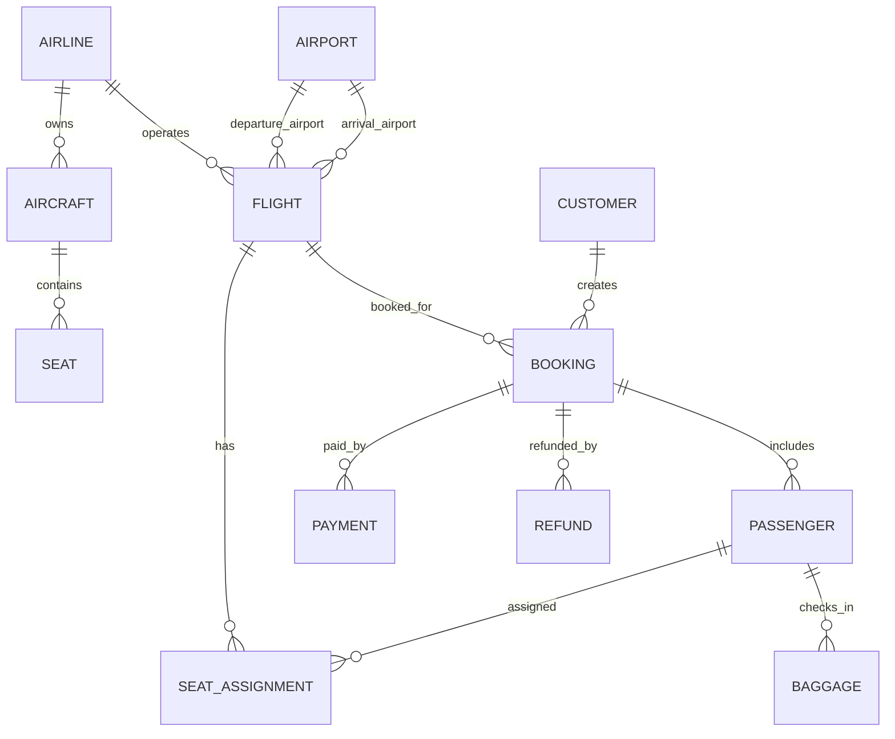
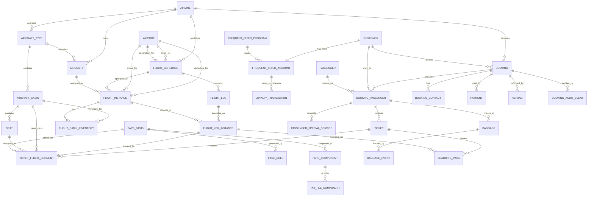
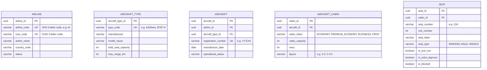
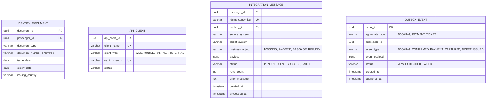

# Simplified ER diagram

Here is a **simplified production-friendly ER model** for a Flight Booking Application. It keeps the essential entities—airports, flights, aircraft, passengers, bookings, seats, payments, and baggage—while avoiding separate schedule/instance, fare-rule, audit, and integration tables.



## Entities and fields

### Airline

Stores airline companies.

```text
AIRLINE
- airline_id (PK)
- airline_code (UK)      -- AI, 6E, UK
- airline_name
- country
- status
```

Example: `AI` = Air India, `6E` = IndiGo.

### Airport

Stores airports.

```text
AIRPORT
- airport_id (PK)
- iata_code (UK)         -- MAA, DEL, BLR
- airport_name
- city
- country
- timezone
```

Example: `MAA` = Chennai International Airport, `DEL` = Delhi Airport.

### Aircraft

Stores individual aircraft.

```text
AIRCRAFT
- aircraft_id (PK)
- airline_id (FK)
- aircraft_model         -- A320neo, B787-9
- registration_number UK -- VT-EXA
- total_seats
- status
```

Example: Air India aircraft `VT-EXA`, an Airbus A320neo with 180 seats.

### Seat

Stores physical seats on an aircraft.

```text
SEAT
- seat_id (PK)
- aircraft_id (FK)
- seat_number            -- 12A, 12B, 12C
- cabin_class            -- ECONOMY, BUSINESS
- seat_type              -- WINDOW, AISLE, MIDDLE
- is_available
```

Example: Seat `12A`, Economy, Window.

### Flight

Stores a scheduled flight on a specific date.

```text
FLIGHT
- flight_id (PK)
- airline_id (FK)
- flight_number          -- AI202
- flight_date            -- 2026-10-18
- origin_airport_id (FK) -- MAA
- destination_airport_id (FK) -- DEL
- departure_time
- arrival_time
- aircraft_id (FK)
- status                 -- SCHEDULED, DELAYED, CANCELLED, COMPLETED
- base_fare
- currency
```

Example: AI202 from Chennai to Delhi on 18-Oct-2026.

### Customer

Stores the person or organization making the booking.

```text
CUSTOMER
- customer_id (PK)
- email UK
- phone
- first_name
- last_name
- date_of_birth
- status
```

Example: A customer books tickets for themselves and family members.

### Booking

Stores one reservation, usually identified by a PNR.

```text
BOOKING
- booking_id (PK)
- pnr UK                 -- ABC123
- customer_id (FK)
- flight_id (FK)
- booking_status         -- PENDING, CONFIRMED, CANCELLED
- total_amount
- currency
- booked_at
- cancelled_at
```

Example: PNR `ABC123`, confirmed booking for AI202.

### Passenger

Stores each traveller included in a booking.

```text
PASSENGER
- passenger_id (PK)
- booking_id (FK)
- first_name
- last_name
- date_of_birth
- passenger_type         -- ADULT, CHILD, INFANT
- passport_number_encrypted
- nationality
```

Example: Two adults and one child can be part of the same booking.

### Seat assignment

Links a passenger to a seat for a flight.

```text
SEAT_ASSIGNMENT
- seat_assignment_id (PK)
- flight_id (FK)
- passenger_id (FK)
- seat_id (FK)
- assignment_fee
- assigned_at
```

Example: Passenger `PAX45678` assigned seat `12A` on AI202.

### Payment

Stores money received for a booking.

```text
PAYMENT
- payment_id (PK)
- booking_id (FK)
- payment_reference UK
- amount
- currency
- payment_method         -- CARD, UPI, NETBANKING, WALLET
- payment_status         -- INITIATED, SUCCESS, FAILED, REFUNDED
- paid_at
```

Example: ₹18,500 paid by UPI for a family booking.

### Refund

Stores refunds against a booking.

```text
REFUND
- refund_id (PK)
- booking_id (FK)
- payment_id (FK)
- refund_amount
- refund_reason
- refund_status          -- REQUESTED, PROCESSED, REJECTED
- refunded_at
```

Example: ₹4,000 refunded after cancelling one passenger’s ticket.

### Baggage

Stores checked-in baggage for a passenger.

```text
BAGGAGE
- baggage_id (PK)
- passenger_id (FK)
- baggage_tag_number UK
- weight_kg
- extra_fee
- status                 -- CHECKED_IN, LOADED, DELIVERED, LOST
```

Example: One 27 kg bag with ₹2,000 excess-baggage fee.

## Relationship summary

| Relationship | Cardinality | Example |
|---|---:|---|
| Airline → Aircraft | 1:N | Air India owns many aircraft |
| Airline → Flight | 1:N | Air India operates AI202, AI674 |
| Aircraft → Seat | 1:N | One aircraft has 180 seats |
| Airport → Flight | 1:N as origin and destination | MAA is origin for AI202 and destination for AI203 |
| Flight → Booking | 1:N | AI202 has many bookings |
| Customer → Booking | 1:N | One customer can make many bookings |
| Booking → Passenger | 1:N | One booking can include several passengers |
| Booking → Payment | 1:N | Booking may have card and wallet payments |
| Booking → Refund | 1:N | Booking may have partial refunds |
| Passenger → Seat assignment | 1:N | Passenger may be assigned seats on different flights |
| Passenger → Baggage | 1:N | Passenger may check in multiple bags |

## Key rules

- A booking belongs to one customer and one flight in this simplified model.
- A booking can contain multiple passengers.
- Each passenger can have one seat assignment per flight.
- A seat can be assigned to only one passenger on a given flight.
- A payment must belong to a booking.
- A refund should reference the original payment.
- Baggage always belongs to a passenger.
- Cancelled bookings and flights should be marked with a status, not deleted.

## Sample flow

**Scenario:** A customer books two Economy seats on AI202 from Chennai to Delhi.

1. Customer is created or retrieved.
2. Flight AI202 is found for 18-Oct-2026.
3. Booking `ABC123` is created.
4. Two passengers are added to the booking.
5. Seats `12A` and `12B` are assigned.
6. Payment of ₹18,500 is recorded.
7. Booking status becomes `CONFIRMED`.
8. Each passenger may later check in baggage.

## When to use this simpler model

Use this model for:

- A learning project.
- A minimum viable product (**MVP**).
- A small airline or charter-booking application.
- A demo where one booking covers one flight.

Use the comprehensive model when you need:

- Multi-city and round-trip itineraries.
- Separate flight schedules and actual flight instances.
- Fare rules, taxes, and ticket-level pricing.
- Cabin-specific inventory and complex seat maps.
- Check-in, boarding passes, loyalty points, and detailed baggage tracking.
- SAP, payment-gateway, and partner-system integrations.

# Production-oriented ER model

Below is a production-oriented ER model for a **Flight Booking Application**. It separates reusable schedule/master data from date-specific operations, which is essential for real airline systems: a flight schedule such as “AI202, Chennai to Delhi, daily” is different from the actual AI202 service on 18-Oct-2026. [databasesample](https://databasesample.com/database/airline-reservation-system-database)

## Design principles

- **Schedule vs instance** — `flight_schedule` defines the recurring flight; `flight_instance` represents one actual operation on a date.
- **Booking vs ticket** — a booking/PNR can contain multiple passengers and multiple flight segments; each passenger receives a ticket.
- **Seat inventory** — seats belong to an aircraft cabin layout, while seat assignments belong to a ticket-flight segment.
- **Money is separate** — fares, taxes, payments, refunds, and loyalty transactions should be separate from booking data for auditability.
- **Airport and aircraft are master data** — they are reused across many flights and schedules.

A production Passenger Name Record (**PNR**) commonly contains traveler details, itinerary segments, fare/ticket information, payment details, special requests, loyalty data, and operational remarks.  IATA describes a PNR as booking information that can include passenger name, itinerary, and ticket indicator, retained by airline reservation systems until check-in. [aviationopsguide](https://aviationopsguide.com/aviation/passenger-data-management/)

## High-level ER diagram



## Core entity groups

| Group | Entities | Purpose |
|---|---|---|
| Airline and fleet | `airline`, `aircraft_type`, `aircraft`, `aircraft_cabin`, `seat` | Define airlines, aircraft models, physical cabins, and seats |
| Network and schedule | `airport`, `route`, `flight_schedule`, `flight_leg`, `flight_instance`, `flight_leg_instance` | Define where flights operate and when each actual flight occurs |
| Inventory | `flight_cabin_inventory`, `seat`, `seat_assignment` | Control available seats and assignments |
| Customer and booking | `customer`, `passenger`, `booking`, `booking_passenger`, `booking_contact` | Manage who books and who travels |
| Ticketing and fare | `ticket`, `ticket_flight_segment`, `fare_basis`, `fare_rule`, `fare_component`, `tax_fee_component` | Price and issue travel documents |
| Payments | `payment`, `payment_method`, `refund`, `loyalty_transaction` | Handle money, refunds, and loyalty points |
| Airport operations | `check_in`, `boarding_pass`, `baggage`, `baggage_event`, `special_service_request` | Support airport and passenger-service workflows |
| Governance | `booking_audit_event`, `idempotency_key`, `integration_message` | Ensure auditability, retries, and integration safety |

## Detailed entity definitions

### Airline and fleet



An airline owns many aircraft; each aircraft belongs to one aircraft type; each aircraft has one or more cabins; each cabin contains many seats. This supports realistic seat maps and cabin-specific inventory.

### Airports, routes, and schedules

```mermaid
erDiagram
    AIRPORT {
        uuid airport_id PK
        varchar iata_code UK "MAA, DEL, BLR"
        varchar icao_code UK "VOMM, VIDP, VOBL"
        varchar airport_name
        varchar city
        varchar country_code
        decimal latitude
        decimal longitude
        varchar timezone
    }

    ROUTE {
        uuid route_id PK
        uuid origin_airport_id FK
        uuid destination_airport_id FK
        int distance_km
        varchar route_status
    }

    FLIGHT_SCHEDULE {
        uuid flight_schedule_id PK
        uuid airline_id FK
        uuid route_id FK
        varchar flight_number "AI202"
        date effective_from
        date effective_to
        varchar days_of_operation "1111100"
        time scheduled_departure_time
        time scheduled_arrival_time
        int scheduled_duration_minutes
        varchar schedule_status
    }

    FLIGHT_LEG {
        uuid flight_leg_id PK
        uuid flight_schedule_id FK
        int leg_sequence
        uuid origin_airport_id FK
        uuid destination_airport_id FK
        time departure_time
        time arrival_time
        int duration_minutes
    }

    FLIGHT_INSTANCE {
        uuid flight_instance_id PK
        uuid flight_schedule_id FK
        date flight_date
        varchar operational_status "SCHEDULED, DELAYED, CANCELLED, COMPLETED"
        uuid aircraft_id FK
        timestamp actual_departure_time
        timestamp actual_arrival_time
        int actual_delay_minutes
        varchar cancellation_reason
    }

    FLIGHT_LEG_INSTANCE {
        uuid flight_leg_instance_id PK
        uuid flight_instance_id FK
        uuid flight_leg_id FK
        timestamp scheduled_departure_time
        timestamp scheduled_arrival_time
        timestamp actual_departure_time
        timestamp actual_arrival_time
        varchar gate
        varchar terminal
        varchar status
    }
```



The schedule/instance split is important. For example:

- `flight_schedule`: AI202, MAA → DEL, daily, departure 06:30.
- `flight_instance`: AI202 on 18-Oct-2026, delayed by 35 minutes.
- `flight_leg_instance`: AI202 leg from MAA to DEL on 18-Oct-2026, gate B7.

A flight can contain multiple legs, such as MAA → HYD → DEL, while still being sold as one itinerary.

## Booking domain

```mermaid
erDiagram
    CUSTOMER {
        uuid customer_id PK
        varchar email UK
        varchar phone
        varchar first_name
        varchar last_name
        date date_of_birth
        varchar customer_type "INDIVIDUAL, CORPORATE, TRAVEL_AGENT"
        varchar status
        timestamp created_at
    }

    BOOKING {
        uuid booking_id PK
        varchar pnr UK "6-character airline reference"
        uuid customer_id FK
        varchar booking_channel "WEB, MOBILE, AGENT, OTA, CORPORATE"
        varchar booking_status "PENDING, CONFIRMED, CANCELLED, COMPLETED"
        decimal total_amount
        varchar currency
        timestamp booked_at
        timestamp cancelled_at
        varchar cancellation_reason
    }

    PASSENGER {
        uuid passenger_id PK
        varchar first_name
        varchar last_name
        date date_of_birth
        varchar gender
        varchar passenger_type "ADULT, CHILD, INFANT"
        varchar nationality
        varchar document_type "PASSPORT, AADHAAR, DRIVING_LICENSE"
        varchar document_number_encrypted
        date document_expiry_date
    }

    BOOKING_PASSENGER {
        uuid booking_passenger_id PK
        uuid booking_id FK
        uuid passenger_id FK
        varchar passenger_role "PRIMARY, COMPANION, INFANT_WITH_SEAT"
        varchar frequent_flyer_number
        boolean is_primary_contact
    }

    BOOKING_CONTACT {
        uuid booking_contact_id PK
        uuid booking_id FK
        varchar contact_type "EMAIL, MOBILE, EMERGENCY"
        varchar contact_value
        boolean is_primary
    }

    BOOKING_AUDIT_EVENT {
        uuid audit_event_id PK
        uuid booking_id FK
        varchar event_type "CREATED, CONFIRMED, MODIFIED, CANCELLED"
        varchar actor_type "CUSTOMER, AGENT, SYSTEM"
        varchar actor_id
        jsonb old_values
        jsonb new_values
        timestamp event_at
    }
```



A **booking** is the commercial container, often identified by a PNR. It can include several passengers and several flight segments. The `booking_passenger` table resolves the many-to-many relationship between bookings and passengers.

## Tickets, segments, and seats

```mermaid
erDiagram
    TICKET {
        uuid ticket_id PK
        uuid booking_passenger_id FK
        varchar ticket_number UK "e.g. 098-1234567890"
        varchar ticket_status "ISSUED, USED, REFUNDED, VOID"
        decimal ticket_total_amount
        varchar currency
        timestamp issued_at
    }

    TICKET_FLIGHT_SEGMENT {
        uuid ticket_flight_segment_id PK
        uuid ticket_id FK
        uuid flight_leg_instance_id FK
        uuid cabin_id FK
        uuid seat_id FK
        uuid fare_basis_id FK
        varchar segment_status "CONFIRMED, WAITLISTED, CHECKED_IN, BOARDED, FLOWN, CANCELLED"
        decimal segment_base_fare
        decimal segment_tax_total
        decimal segment_total_amount
        varchar currency
    }

    SEAT_ASSIGNMENT {
        uuid seat_assignment_id PK
        uuid ticket_flight_segment_id FK
        uuid seat_id FK
        varchar assignment_type "FREE, PAID, PREFERRED, EMERGENCY_EXIT"
        decimal assignment_fee
        timestamp assigned_at
    }

    FARE_BASIS {
        uuid fare_basis_id PK
        varchar fare_basis_code UK "e.g. YLOWIN, BSAVER"
        varchar cabin_class
        varchar booking_class "Y, B, M, H"
        boolean is_refundable
        boolean is_changeable
        int baggage_allowance_kg
        date effective_from
        date effective_to
    }

    FARE_RULE {
        uuid fare_rule_id PK
        uuid fare_basis_id FK
        varchar rule_type "CHANGE, CANCELLATION, NO_SHOW, BAGGAGE"
        jsonb rule_details
        date effective_from
        date effective_to
    }

    FARE_COMPONENT {
        uuid fare_component_id PK
        uuid ticket_flight_segment_id FK
        varchar component_type "BASE_FARE, FUEL_SURCHARGE, AIRPORT_FEE"
        decimal amount
        varchar currency
    }

    TAX_FEE_COMPONENT {
        uuid tax_fee_component_id PK
        uuid fare_component_id FK
        varchar tax_code "UGF, YQ, YR, PSF"
        varchar tax_name
        decimal amount
        varchar currency
    }
```



For a round trip, one ticket can contain two `ticket_flight_segment` rows:

- MAA → DEL on AI202.
- DEL → MAA on AI203.

Each segment can have its own fare, cabin, seat, and status.

## Payments and loyalty

```mermaid
erDiagram
    PAYMENT {
        uuid payment_id PK
        uuid booking_id FK
        varchar payment_reference UK
        decimal amount
        varchar currency
        varchar payment_status "INITIATED, AUTHORIZED, CAPTURED, FAILED, REFUNDED"
        varchar payment_method
        timestamp payment_at
        varchar gateway_name
        varchar gateway_transaction_id
    }

    PAYMENT_METHOD {
        uuid payment_method_id PK
        varchar method_type "CARD, UPI, NETBANKING, WALLET, LOYALTY_POINTS"
        varchar provider
        varchar masked_identifier "XXXX-XXXX-XXXX-1234"
        boolean is_default
    }

    REFUND {
        uuid refund_id PK
        uuid booking_id FK
        uuid payment_id FK
        decimal refund_amount
        varchar currency
        varchar refund_reason
        varchar refund_status "REQUESTED, APPROVED, PROCESSED, REJECTED"
        timestamp requested_at
        timestamp processed_at
    }

    FREQUENT_FLYER_PROGRAM {
        uuid program_id PK
        uuid airline_id FK
        varchar program_name "Flying Returns"
        varchar program_code UK
        varchar status
    }

    FREQUENT_FLYER_ACCOUNT {
        uuid account_id PK
        uuid customer_id FK
        uuid program_id FK
        varchar membership_number UK
        varchar tier "BLUE, SILVER, GOLD, PLATINUM"
        int available_points
        timestamp enrolled_at
    }

    LOYALTY_TRANSACTION {
        uuid loyalty_transaction_id PK
        uuid account_id FK
        uuid booking_id FK
        varchar transaction_type "EARN, REDEEM, REVERSAL, EXPIRY"
        int points
        decimal monetary_value
        timestamp transaction_at
    }
```



A booking can have multiple payments—for example, part paid by credit card and part by loyalty points. Refunds should reference the original payment, not merely the booking.

## Check-in, baggage, and services

```mermaid
erDiagram
    CHECK_IN {
        uuid check_in_id PK
        uuid ticket_flight_segment_id FK
        varchar check_in_channel "WEB, MOBILE, KIOSK, COUNTER"
        timestamp checked_in_at
        varchar boarding_sequence
        varchar status
    }

    BOARDING_PASS {
        uuid boarding_pass_id PK
        uuid ticket_flight_segment_id FK
        uuid check_in_id FK
        varchar boarding_pass_number UK
        varchar barcode_value
        varchar boarding_group
        timestamp issued_at
        varchar status "ISSUED, SCANNED, VOID"
    }

    BAGGAGE {
        uuid baggage_id PK
        uuid booking_passenger_id FK
        varchar baggage_tag_number UK
        decimal weight_kg
        int piece_count
        decimal charged_fee
        varchar baggage_status "CHECKED_IN, LOADED, TRANSFERRED, DELIVERED, LOST"
    }

    BAGGAGE_EVENT {
        uuid baggage_event_id PK
        uuid baggage_id FK
        varchar event_type "SCANNED, LOADED, UNLOADED, TRANSFERRED, DELIVERED"
        uuid airport_id FK
        timestamp event_at
        varchar location
    }

    PASSENGER_SPECIAL_SERVICE {
        uuid special_service_id PK
        uuid booking_passenger_id FK
        varchar ssr_code "WCHR, MEAL_AVML, PETC, UMNR"
        varchar description
        varchar status "REQUESTED, CONFIRMED, REJECTED"
        timestamp requested_at
    }
```



Examples:

- `WCHR` — wheelchair assistance.
- `AVML` — Asian vegetarian meal.
- `UMNR` — unaccompanied minor.
- `PETC` — pet in cabin.

Baggage events create a trackable history: checked in at MAA, loaded, transferred at DEL, and delivered.

## Operational and integration tables



The `integration_message` and `outbox_event` tables make the system production-safe: if SAP, payment gateway, loyalty, or baggage systems are temporarily unavailable, events can be retried without creating duplicates.

## Key relationships

| Relationship | Cardinality | Example |
|---|---:|---|
| Airline → Aircraft | 1:N | Air India owns many aircraft |
| Aircraft type → Aircraft | 1:N | A320neo type has many individual aircraft |
| Aircraft → Cabin | 1:N | One aircraft has Economy and Business cabins |
| Cabin → Seat | 1:N | Business cabin has seats 1A–3F |
| Airport → Route | 2:N via origin/destination | MAA → DEL |
| Flight schedule → Flight instance | 1:N | Daily AI202 has one instance per date |
| Flight instance → Flight leg instance | 1:N | AI202 may have MAA→HYD and HYD→DEL legs |
| Booking → Booking passenger | 1:N | One PNR includes three passengers |
| Booking passenger → Ticket | 1:N | One passenger may have separate tickets for rebooking |
| Ticket → Ticket flight segment | 1:N | Round-trip ticket has outbound and return segments |
| Ticket flight segment → Seat assignment | 1:1 or 0:1 | Seat 12A assigned after seat selection |
| Booking → Payment | 1:N | Card payment plus loyalty redemption |
| Booking → Refund | 1:N | Partial refund for one cancelled segment |
| Passenger → Baggage | 1:N | Passenger checks in two bags |
| Baggage → Baggage event | 1:N | Baggage scan/load/delivery history |

## Important constraints

### Primary keys

Use surrogate UUIDs for internal primary keys, but retain business identifiers as unique keys:

| Table | Primary key | Business unique key |
|---|---|---|
| `airline` | `airline_id` | `airline_code` |
| `airport` | `airport_id` | `iata_code`, `icao_code` |
| `aircraft` | `aircraft_id` | `registration_number` |
| `flight_schedule` | `flight_schedule_id` | `airline_id + flight_number + effective_from` |
| `flight_instance` | `flight_instance_id` | `flight_schedule_id + flight_date` |
| `booking` | `booking_id` | `pnr` |
| `ticket` | `ticket_id` | `ticket_number` |
| `payment` | `payment_id` | `payment_reference` |

### Foreign keys

Critical foreign keys:

```text
aircraft.airline_id              → airline.airline_id
aircraft.aircraft_type_id        → aircraft_type.aircraft_type_id
flight_schedule.route_id         → route.route_id
flight_instance.flight_schedule_id → flight_schedule.flight_schedule_id
flight_instance.aircraft_id      → aircraft.aircraft_id
booking.customer_id              → customer.customer_id
booking_passenger.booking_id     → booking.booking_id
booking_passenger.passenger_id   → passenger.passenger_id
ticket.booking_passenger_id      → booking_passenger.booking_passenger_id
ticket_flight_segment.ticket_id  → ticket.ticket_id
ticket_flight_segment.flight_leg_instance_id → flight_leg_instance.flight_leg_instance_id
payment.booking_id               → booking.booking_id
refund.payment_id                → payment.payment_id
baggage.booking_passenger_id     → booking_passenger.booking_passenger_id
```

### Business rules

- A `flight_instance` must have exactly one scheduled departure airport and one scheduled arrival airport through its flight legs.
- A passenger cannot occupy the same seat twice on the same `flight_leg_instance`.
- A seat assignment must match the cabin assigned to the ticket-flight segment.
- A ticket segment cannot be checked in unless the booking is confirmed and payment is captured or appropriately guaranteed.
- An infant without a seat should not consume seat inventory.
- A refund cannot exceed the eligible amount calculated from fare rules and payment history.
- A cancelled flight should retain historical records; do not physically delete flight instances.
- Every state-changing integration should have an idempotency key.

## Recommended indexes

| Table | Index columns | Reason |
|---|---|---|
| `flight_instance` | `flight_date`, `origin_airport_id`, `status` | Airport departure boards and search |
| `flight_instance` | `flight_schedule_id`, `flight_date` | Prevent duplicate daily instances |
| `ticket_flight_segment` | `flight_leg_instance_id`, `segment_status` | Passenger manifests and seat inventory |
| `ticket_flight_segment` | `ticket_id` | Retrieve all segments for a ticket |
| `booking` | `pnr` | Fast booking lookup |
| `booking` | `customer_id`, `booked_at` | Customer booking history |
| `payment` | `booking_id`, `payment_status` | Payment reconciliation |
| `integration_message` | `idempotency_key` | Duplicate prevention |
| `integration_message` | `status`, `retry_count`, `created_at` | Retry scheduler |
| `seat` | `cabin_id`, `seat_number` | Seat-map lookup |
| `baggage_event` | `baggage_id`, `event_at` | Baggage tracking timeline |

## Sample data flow

### Booking a one-way flight

1. Customer searches MAA → DEL for 18-Oct-2026.
2. System finds `flight_schedule` AI202 and creates or retrieves `flight_instance`.
3. System reads `flight_cabin_inventory` for available Economy seats.
4. Customer selects seat 12A.
5. System creates:
   - `booking`
   - `booking_passenger`
   - `ticket`
   - `ticket_flight_segment`
   - `fare_component` and `tax_fee_component`
   - `payment`
   - `seat_assignment`
6. Payment succeeds.
7. Booking status becomes `CONFIRMED`.
8. Ticket status becomes `ISSUED`.
9. An `outbox_event` named `BOOKING_CONFIRMED` is created.
10. SAP, loyalty, and notification systems receive the event through the integration layer.

### Check-in and baggage

1. Passenger checks in for the MAA → DEL segment.
2. `check_in` record is created.
3. `boarding_pass` is issued.
4. Passenger checks one 27 kg bag.
5. `baggage` is created with a ₹2,000 excess-baggage fee.
6. `baggage_event` records `CHECKED_IN` at MAA.
7. Later events record `LOADED`, `TRANSFERRED`, and `DELIVERED`.

## What to avoid

- Do not store `origin_airport` and `destination_airport` only on `booking`; store them on routes, schedules, and flight-leg instances.
- Do not treat a flight number as globally unique; AI202 can operate on many dates.
- Do not store seat availability only as a count; model cabins and seats if seat selection is required.
- Do not put fare rules as free text only; use structured `fare_rule` data.
- Do not delete cancelled bookings or flights; use status fields and audit events.
- Do not couple payment success directly to ticket issuance without an idempotent, recoverable workflow.
- Do not store raw passport, card, or government-ID numbers in plain text.

## Minimal production table list

For a real production build, start with these tables:

1. `airline`
2. `airport`
3. `route`
4. `aircraft_type`
5. `aircraft`
6. `aircraft_cabin`
7. `seat`
8. `flight_schedule`
9. `flight_leg`
10. `flight_instance`
11. `flight_leg_instance`
12. `flight_cabin_inventory`
13. `customer`
14. `passenger`
15. `booking`
16. `booking_passenger`
17. `booking_contact`
18. `fare_basis`
19. `fare_rule`
20. `ticket`
21. `ticket_flight_segment`
22. `seat_assignment`
23. `fare_component`
24. `tax_fee_component`
25. `payment`
26. `refund`
27. `loyalty_program`
28. `loyalty_account`
29. `loyalty_transaction`
30. `check_in`
31. `boarding_pass`
32. `baggage`
33. `baggage_event`
34. `special_service_request`
35. `booking_audit_event`
36. `integration_message`
37. `outbox_event`

This model supports passenger booking, multi-leg itineraries, fare rules, payments, refunds, seat maps, check-in, boarding, baggage tracking, loyalty, cancellation, auditing, and SAP/external-system integration. Airline reservation systems commonly need to manage inventory, fares, ticketing, payments, passengers, flights, aircraft, routes, and airport data together. [databasesample](https://databasesample.com/database/airline-reservation-system-database)
